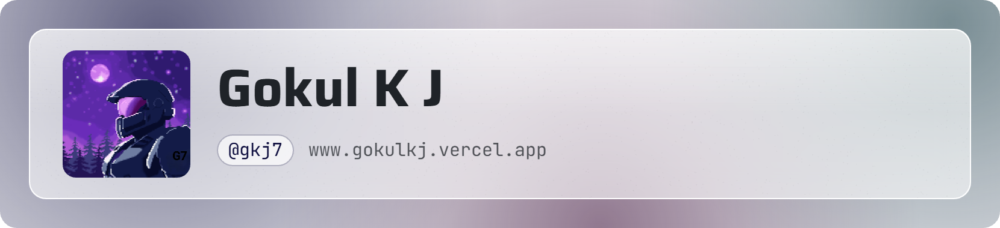
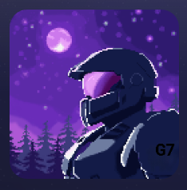

<!--
  GOKUL K J — GitHub Profile README
  Repository: https://github.com/gkj7/gkj7

  Keep the `art/` directory in the repository root.
  The supplied light/dark banner files are used without modification.
-->

<!-- Custom responsive banner supplied by Gokul -->
<picture>
  <source media="(prefers-color-scheme: dark)" srcset="art/header-dark.png">
  <source media="(prefers-color-scheme: light)" srcset="art/header-light.png">
  
</picture>

 

  

**Status: Secure** &nbsp;·&nbsp; **Break, Fix, Repeat.**

---

<h2 align="center">✦ ABOUT ME ✦</h2>

<table>
  <tr>
    <td width="65%" valign="middle">
      <h3>Hey, I'm Gokul 👋</h3>
      
I'm a cybersecurity enthusiast from Kerala, India, interested in understanding how systems work, how they fail, and how to make them more secure.

      <ul>
        <li>🔐 Exploring <strong>offensive and defensive security</strong></li>
        <li>🌱 Currently learning and growing in <strong>cybersecurity</strong></li>
        <li>🧭 Interested in <strong>ethical hacking, cloud security, and Linux</strong></li>
        <li>🎯 Goal: <strong>Break into the cybersecurity field</strong></li>
        <li>🤝 Open to <strong>CTFs and hackathons</strong></li>
        <li>📚 Personal motto: <strong>Learner for life</strong></li>
      </ul>
    </td>
    <td width="35%" align="center" valign="middle">
      
    </td>
  </tr>
</table>

---

<h2 align="center">✦ TECH STACK ✦</h2>

**Languages**

  

**Systems & Developer Tools**

  

**Security Toolkit & Learning Platforms**

  

---

<h2 align="center">✦ GITHUB STATISTICS ✦</h2>

  

---

<h2 align="center">✦ CONNECT WITH ME ✦</h2>

  

*Always learning. Always exploring. Always securing.*

 

  

